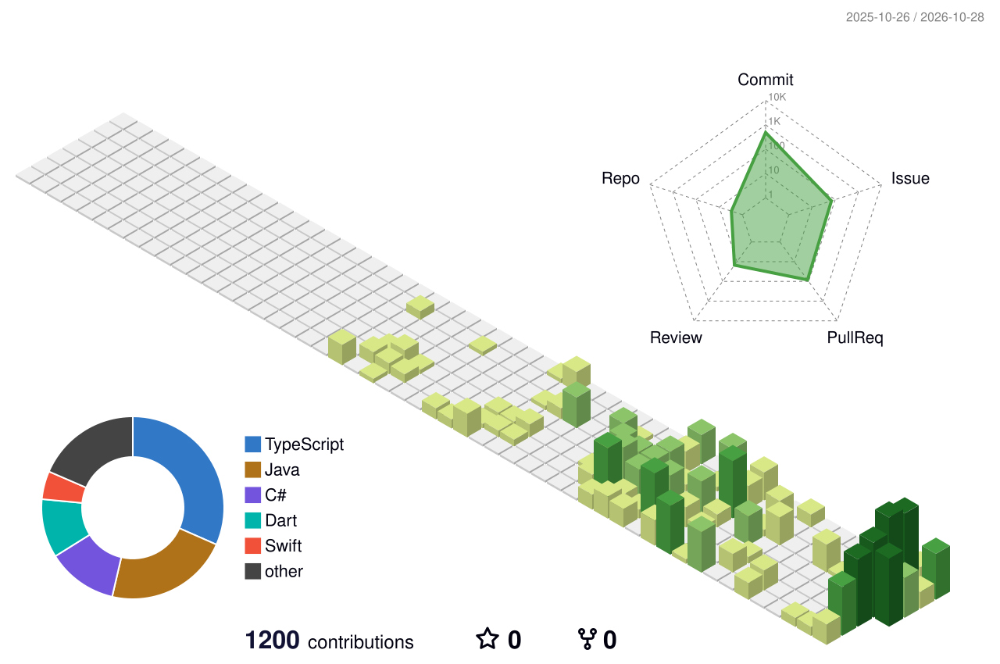

    

 

<!-- ============ INTRO ============ -->

### Welcome to Seoyoon's GitHub 🍓

 

<small>
🙋🏻‍♀️ Name : Seoyoon Bae 
🏫 Edu : Hanyang University, ERICA 
🎓 Major : Division of ICT, Computer Science 
</small>

 

  

<!-- ============ TECH STACKS ============ -->

### Tech Stacks

 

<!-- Languages & Frontend -->

 

<!-- Backend & Database -->

 

<!-- Build Tools, AI & Infra -->

  

<!-- ============ KEY PROJECTS ============ -->

### Featured Projects

 

   

  
 <b>MAP</b>    <b>Frontend </b>– 모빌리티(PM) 기반 맞춤 여행 경로 추천 서비스 

  
   

**기간:** 2026.04 ~ 2026.08 
**주요 기능:** AI 기반 경로 추천 시스템 UI 구현, 지도 API 연동

 

  

  
 <b>MuseReview</b>   <b>Frontend </b>– 나의 연주 습관과 화성학적 의도를 정밀 분석하여, 독학 중에도 레슨 경험을 제공하는 AI 음악 멘토링 플랫폼 

   

**기간:** 2026.06 ~ 2026.08 
**주요 기능:** AI 음악 분석 결과 피드백 UI 구현, 인터랙티브 악보/음원 플레이어 인터페이스 개발

 

  

  
 <b>Cramit</b>   <b>Backend · Infra </b>– 나만의 스마트한 학습 어시스턴트 

   

**기간:** 2026.06 ~ 
**주요 기능:** Spring Boot 기반 백엔드 API 설계 및 구축, GCP/Docker를 활용한 클라우드 인프라 파이프라인 구성

 

  

  
 <b>SAGO</b>   <b>Backend · AI </b> – AI 기반 배달 라이더 사고 즉시 대응 및 3D 사고 재현 증빙 플랫폼 

   

**기간:** 2026.07 ~ 
**주요 기능:** Gemini API 기반 사고 정황 분석 및 백엔드 파이프라인 구축, 실시간 데이터 처리(SSE) 및 3D 재현 데이터 연동

 

 

<!-- ============ CONTACT ============ -->

 

 

### Contact

✉️ Mail : bsyoon1204@gmail.com
 

 
 

<!-- ============ 3D CONTRIBUTION ============ -->

&nbsp;&nbsp;&nbsp;&nbsp;&nbsp;&nbsp;&nbsp;&nbsp;&nbsp;&nbsp;&nbsp;&nbsp;&nbsp;&nbsp;&nbsp;&nbsp;

