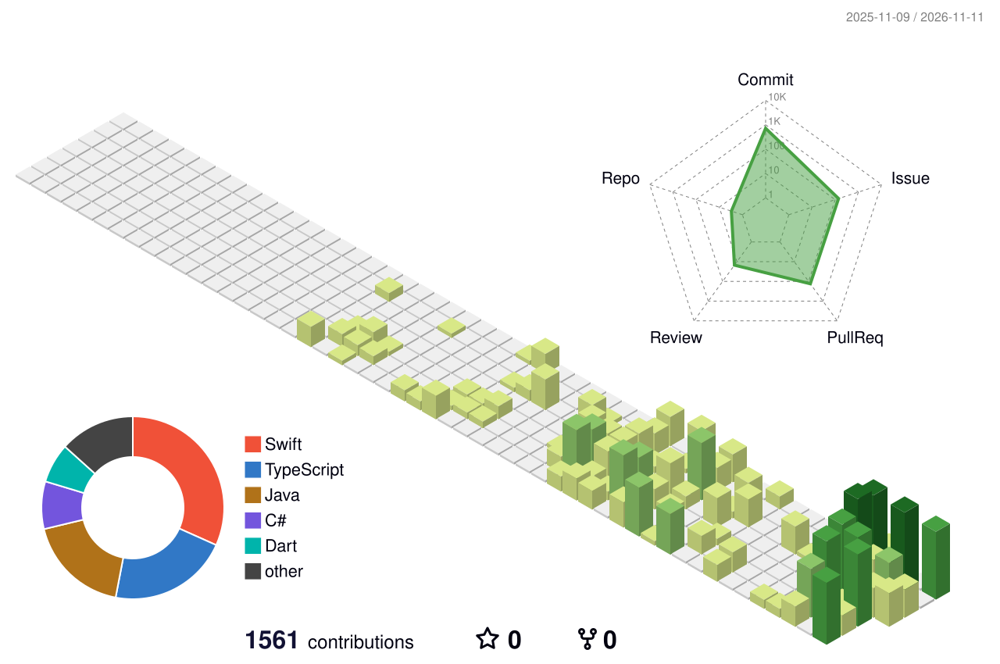

  

 

<!-- ============ INTRO ============ -->

### Welcome to Seoyoon's GitHub

 

<small>
🙋🏻‍♀️ Name : Seoyoon Bae 
🏫 Edu : Hanyang University, ERICA 
🎓 Major : Division of ICT, Computer Science 
</small>

 

  

<!-- ============ TECH STACKS ============ -->

### Tech Stacks

<table bgcolor="#ffffff">
  <tr>
    <td align="left" width="240" bgcolor="#ffffff"><b>Languages</b></td>
    <td bgcolor="#ffffff">
      
      
      
      
      
      
    </td>
  </tr>
  <tr>
    <td align="left" bgcolor="#ffffff"><b>Frontend · Mobile</b></td>
    <td bgcolor="#ffffff">
      
      
      
      
      
    </td>
  </tr>
  <tr>
    <td align="left" bgcolor="#ffffff"><b>Backend</b></td>
    <td bgcolor="#ffffff">
      
      
      
      
    </td>
  </tr>
  <tr>
    <td align="left" bgcolor="#ffffff"><b>AI · Data</b></td>
    <td bgcolor="#ffffff">
      
      
      
      
    </td>
  </tr>
  <tr>
    <td align="left" bgcolor="#ffffff"><b>Database</b></td>
    <td bgcolor="#ffffff">
      
      
    </td>
  </tr>
  <tr>
    <td align="left" bgcolor="#ffffff"><b>Cloud · DevOps</b></td>
    <td bgcolor="#ffffff">
      
      
      
      
      
    </td>
  </tr>
  <tr>
    <td align="left" bgcolor="#ffffff"><b>Tools · Others</b></td>
    <td bgcolor="#ffffff">
      
      
      
      
      
      
    </td>
  </tr>
</table>

  

<!-- ============ KEY PROJECTS ============ -->

    
### Featured Projects
    

자세히 보기

 

<!-- Project 1: MAP -->

  

<b>MAP</b> <b>Frontend </b>– 모빌리티(PM) 기반 맞춤 여행 경로 추천 서비스

 

<b>기간:</b> 2026.04 ~ 2026.08 
<b>주요 기능:</b> AI 기반 경로 추천 시스템 UI 구현, 지도 API 연동

 

   

<!-- Project 2: MuseReview -->

  

<b>MuseReview</b> <b>Frontend </b>– 나의 연주 습관과 화성학적 의도를 정밀 분석하여, 독학 중에도 레슨 경험을 제공하는 AI 음악 멘토링 플랫폼

 

<b>기간:</b> 2026.06 ~ 2026.08 
<b>주요 기능:</b> AI 음악 분석 결과 피드백 UI 구현, 인터랙티브 악보/음원 플레이어 인터페이스 개발

 

   

<!-- Project 3: Cramit -->

  

<b>Cramit</b> <b>Backend · Infra </b>– 나만의 스마트한 학습 어시스턴트

 

<b>기간:</b> 2026.06 ~ 2026.12 
<b>주요 기능:</b> Spring Boot 기반 백엔드 API 설계 및 구축, GCP/Docker를 활용한 클라우드 인프라 파이프라인 구성

 

   

<!-- Project 4: SAGO -->

  

<b>SAGO</b> <b>Backend · AI </b> – AI 기반 배달 라이더 사고 즉시 대응 및 3D 사고 재현 증빙 플랫폼

 

<b>기간:</b> 2026.07 ~ 
<b>주요 기능:</b> Gemini API 기반 사고 정황 분석 및 백엔드 파이프라인 구축, 실시간 데이터 처리(SSE) 및 3D 재현 데이터 연동

 

  

<!-- ============ SUB PROJECTS ============ -->
  

    
### Sub Projects

자세히 보기

  

 

<!-- ============ CONTACT ============ -->

 

### Contact

✉️ Mail : bsyoon1204@gmail.com

 

    
<!-- ============ 3D CONTRIBUTION ============ -->

&nbsp;&nbsp;&nbsp;&nbsp;&nbsp;&nbsp;&nbsp;&nbsp;&nbsp;&nbsp;&nbsp;&nbsp;&nbsp;&nbsp;&nbsp;&nbsp;

